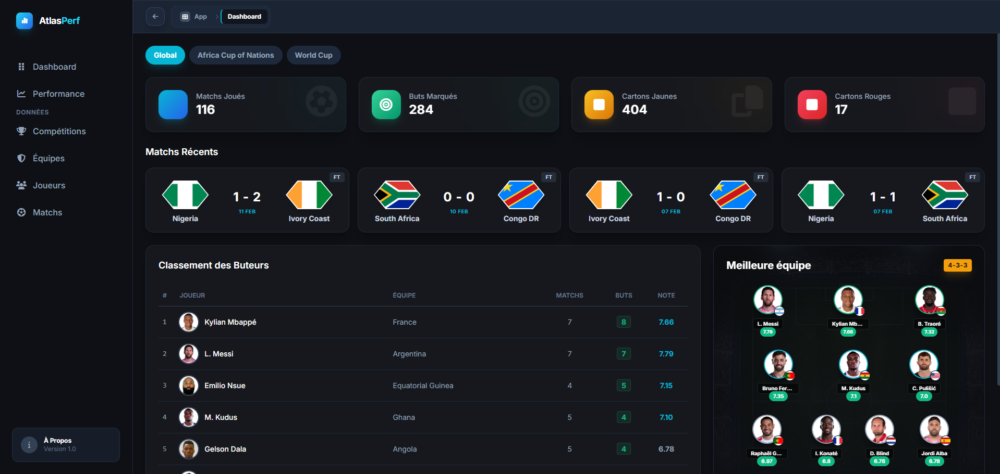
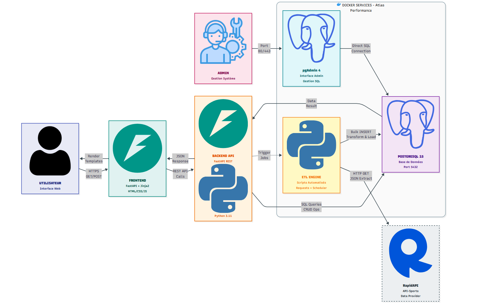

# ⚽ AtlasPerformance

**AtlasPerformance** est une plateforme avancée d'analyse de données footballistiques, couvrant la **Coupe du Monde de la FIFA** et la **Coupe d'Afrique des Nations (CAN)**.

Le projet collecte, traite (ETL) et visualise des données via un dashboard interactif, offrant des insights sur les performances des joueurs, des équipes et des matchs.



---

## 🚀 Commencer

### 📥 Installation Rapide

```powershell
# 1. Cloner
git clone https://github.com/badr-abba/atlasperformance.git
cd atlasperformance

# 2. Configurer (.env)
copy .env.example .env
# (Ajoutez votre clé RAPIDAPI_KEY dans le fichier .env)

# 3. Lancer (Docker)
docker-compose up -d --build

# 4. Charger les données
.\scripts\run_etl.ps1
```

> 📘 Pour un guide détaillé étape par étape, consultez le [Guide d'Installation complet](docs/SETUP.md).

---

## 📚 Documentation

Toute la documentation du projet est centralisée dans le dossier `docs/` :

| Guide | Description |
|-------|-------------|
| 🏗️ **[Architecture](docs/ARCHITECTURE.md)** | Stack technique, structure du code, base de données. |
| 🚀 **[Installation](docs/SETUP.md)** | Prérequis, configuration Docker, variables d'environnement. |
| 🔄 **[ETL Guide](docs/ETL_GUIDE.md)** | Fonctionnement du pipeline de données (Extraction, Stats avancées). |
| 📖 **[Guide Utilisateur](docs/USER_GUIDE.md)** | Tour des fonctionnalités du Dashboard (Filtres, Recherche, Graphiques). |
| 🔌 **[API Reference](docs/API_REFERENCE.md)** | Endpoints disponibles (Swagger UI). |

---

## 🏗️ Architecture du Système

Le schéma ci-dessous illustre l'architecture globale du projet AtlasPerformance :



---

## 📊 Fonctionnalités Principales

*   **Dashboard Dynamique** : KPIs en temps réel, filtres par compétition.
*   **Stats Matchs** : Comparaison détaillée (Possession, xG, Tirs).
*   **Analyses Joueurs** : Graphiques radar, évolution des notes dans le temps.
*   **Recherche Instantanée** : Trouvez n'importe quelle équipe ou joueur.
*   **Light/Dark Mode** : Interface sombre professionnelle (Dark Mode par défaut).

---

## 👥 Auteur
**Université Hassan II de Casablanca** - Projet Master Big Data & Cloud Computing.
*Année 2025/2026*
