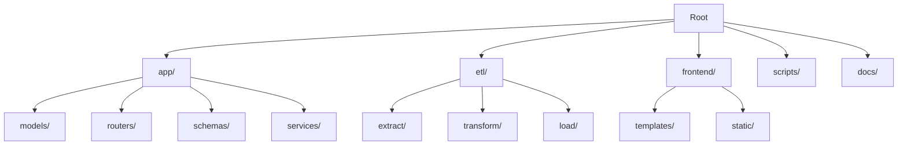

# 🏗️ Architecture du Projet AtlasPerformance

## 🛠️ Stack Technique

### Backend
*   **Langage** : Python 3.11
*   **Framework** : FastAPI (Rapide, Asynchrone, Auto-doc)
*   **ORM** : SQLAlchemy 2.0 (Interaction base de données)
*   **Validation** : Pydantic V2

### Database
*   **Système** : PostgreSQL 15
*   **Gestion** : Docker Container (`atlas_db`)
*   **Administration** : pgAdmin 4 (Container `atlas_pgadmin`)

### Frontend
*   **Moteur de Templates** : Jinja2 (Rendu côté serveur)
*   **CSS** : Tailwind CSS (Via CDN pour développement rapide)
*   **Interactivité** : Vanilla JS
*   **Visualisation** : Plotly.js (Graphiques interactifs)
*   **Icônes** : FontAwesome 6

### Infrastructure & DevOps
*   **Conteneurisation** : Docker & Docker Compose
*   **ETL** : Scripts Python personnalisés avec `requests`
*   **CI/CD** : GitHub Actions (Build & Test)

---

## 📂 Structure du Projet

### Détail des Dossiers

*   **`app/`** : Cœur de l'application Web.
    *   `main.py` : Point d'entrée FastAPI.
    *   `models/` : Définitions des tables SQL (Competition, Team, Match, Player, Performance, MatchStatistic).
    *   `routers/` : Endpoints API organisés par domaine.
    *   `services/` : Logique métier complexe (Calcul de notes, Agrégations).

*   **`etl/`** : Pipeline d'Extraction, Transformation et Chargement.
    *   Moteur de collecte de données depuis API-Football v3.
    *   Gère le cache JSON pour l'optimisation.

*   **`frontend/`** : Interface Utilisateur.
    *   `templates/` : Pages HTML modulaires (Layout base.html + Pages spécifiques).
    *   `static/` : Scripts JS, Styles, Images.

---

## 🗄️ Modélisation des Données (Schéma Simplifié)

La base de données est structurée autour de ces entités principales :

1.  **Competition** : (ex: World Cup, CAN)
2.  **Team** : Équipes participantes.
3.  **Match** : Rencontres (liées à Competition, HomeTeam, AwayTeam).
4.  **Player** : Joueurs (liés à Team).
5.  **Performance** : Statistiques individuelles d'un joueur dans un match spécifique (Note, Buts, Passes...).
6.  **MatchStatistic** : Statistiques globales d'un match par équipe (Possession, Tirs, Corners...).
